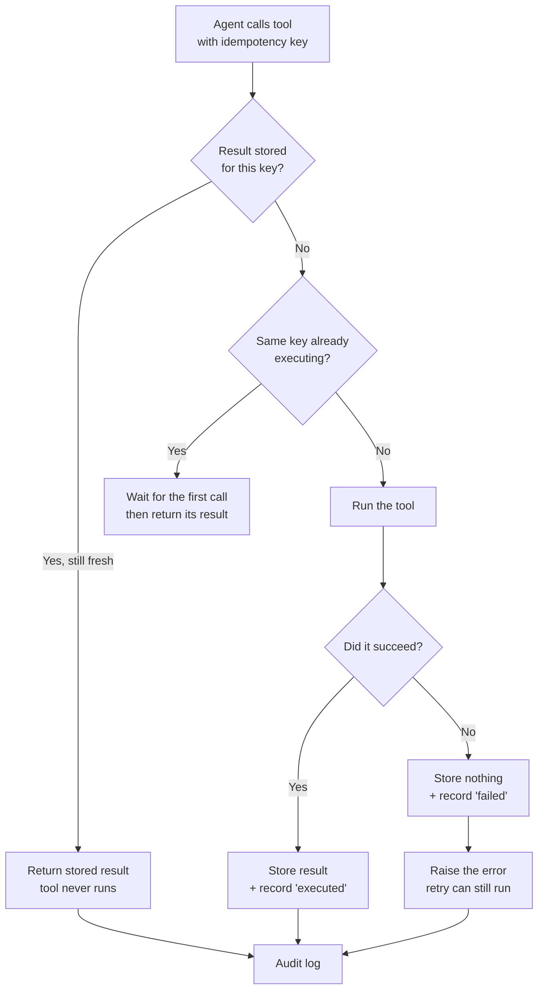

# agent-idempotency-kit

**Stop your agent from charging the customer twice.**

An agent calls a tool — charge a card, book an appointment, issue a refund — and the call times out. Did it go through? The agent can't tell, so it retries. If the first call actually went through, the customer just got charged twice.

This kit is a small, zero-dependency Python wrapper that makes the retry safe: the first call executes and its result is stored under an idempotency key, and every retry with the same key gets the stored result back without the tool running again.

## The problem, in 30 seconds

Run the demo:

```
python demo.py
```

It uses a deliberately flaky payment gateway — the first call times out — and shows both worlds:

```
agent-idempotency-kit demo
======================================================================

PART 1 -- no idempotency: the agent retries a timed-out charge
----------------------------------------------------------------------
  attempt 1: gateway timed out -- response lost (no charge applied)
  attempt 2: charged $24.50, but the receipt was lost (agent crashed)
  attempt 3: agent retries -- charged $24.50 AGAIN
  => customer was charged $49.00 for a $24.50 order (2 charges)

PART 2 -- with the kit: the same flaky gateway, one charge
----------------------------------------------------------------------
  attempt 1: gateway timed out -- response lost (nothing stored -- the key is not poisoned)
  attempt 2: executed once, receipt rcpt-A-103-1
  attempt 3: replayed stored receipt rcpt-A-103-1 -- tool did not run again
  => customer was charged $24.50 for a $24.50 order (1 charge)
  audit: 1 executed, 1 replayed, 1 failed

PART 3 -- five identical calls at once collapse into one execution
----------------------------------------------------------------------
  5 threads, 1 distinct receipt(s), 1 charge(s) applied
  audit: 1 executed, 4 replayed

PART 4 -- file store: the result survives a process restart
----------------------------------------------------------------------
  before restart: executed, receipt rcpt-A-105-1
  after restart: replayed stored receipt rcpt-A-105-1 -- tool did not run again
  => 1 charge(s) applied in total

SUMMARY
======================================================================
  without the kit:  $49.00 charged for a $24.50 order (double charge)
  with the kit:     $24.50 charged (exactly once)
  5 concurrent duplicates: 1 execution
  across a restart: 1 execution

All demo assertions passed.
```

## How it works



One key idea: **a failure stores nothing.** If the tool raises, the key stays clean and a later retry can still execute. A failed call never blocks the operation forever.

## Quickstart

No dependencies, Python 3.10+. Just copy the `idempotency_kit` package into your project, or clone this repo.

```python
from idempotency_kit import MemoryStore, idempotent

@idempotent(store=MemoryStore(), ttl_seconds=3600)
def charge_card(order_id, amount):
    return gateway.charge(order_id, amount)

# The caller supplies one key per logical operation.
receipt = charge_card("A-103", 24.50, idempotency_key="order-A-103-charge-1")

# A retry -- timeout, crash, duplicate dispatch -- returns the stored
# receipt. The gateway is never called a second time.
receipt = charge_card("A-103", 24.50, idempotency_key="order-A-103-charge-1")
```

## Wrapping a tool

Three ways to get the key:

```python
# 1. The caller passes idempotency_key=... (shown above). Best when the
#    caller owns the operation id -- an order id, a booking reference.

# 2. Derive it from the arguments, so callers don't have to think:
from idempotency_kit import wrap

charge = wrap(gateway.charge, store=MemoryStore(),
              key=lambda order_id, amount: f"order:{order_id}")

# 3. Do nothing: the key is derived from the function name and its
#    arguments automatically. Same args, same key.
```

Check what happened afterwards through the audit log:

```python
audit = charge_card.idempotency_audit
len(audit.executed())   # calls that really ran
len(audit.replayed())   # retries served from the stored result
len(audit.failed())     # calls that raised (and stored nothing)
```

## TTL and stores

**TTL** — `ttl_seconds` (default 3600) is how long a stored result stays valid. After it expires, the same key executes again. Set it to match the operation: an hour is fine for a payment retry window; a booking might want a day. There is no "forever" mode on purpose — a key that never expires is a key that can never be intentionally re-run.

**Stores** — two ship with the kit:

| Store | Good for | Results must be |
|---|---|---|
| `MemoryStore` | one process, tests, short-lived agents | any Python object |
| `FileStore(path)` | surviving restarts, single-machine agents | JSON-serialisable |

```python
from idempotency_kit import FileStore

charge = wrap(gateway.charge, store=FileStore("charges.json"))
# After a restart, a new FileStore on the same file still replays.
```

`FileStore` writes atomically (temp file + rename), so a crash mid-write can't corrupt it. If a result isn't JSON-serialisable it raises `TypeError` at store time, loudly, instead of failing on the next restart.

## What this does not do

Be straight about the limit: this is a **client-side** wrapper. It guarantees the tool function runs at most once per key for calls whose outcome it can observe. If the tool applies a side effect and *then* raises — the charge went through, the network died before the receipt came back — no wrapper can un-charge it. That case needs the downstream system itself to accept the key, the way Stripe does. What the kit guarantees is that retries and duplicate dispatches never re-execute a call that already produced a stored result. The demo's flaky gateway fails *before* moving money, which is exactly the failure mode this fixes.

## Tests

```
python -m unittest discover -s tests -v
```

15 tests, all passing, no third-party dependencies. They cover: same key replays without re-executing, concurrent duplicates execute once, different keys execute separately, expired keys re-execute, failures don't poison the key, the audit log tells executed apart from replayed, and the file store surviving a restart.

## Lessons

- **Retries are the bug, not the fix.** The timeout isn't what double-charges the customer — the blind retry is.
- **Store the result, not just a flag.** Returning the stored receipt means the retrying caller gets a real answer, not a "maybe it worked."
- **Failures must not poison the key.** A key that gets stuck after one error is worse than no key at all — it turns a transient failure into a permanent one.
- **Duplicates are a concurrency problem too.** Two identical calls landing at the same moment need the same protection as a retry five minutes later. The losers wait and share the winner's result.

## License

MIT — see [LICENSE](LICENSE).
